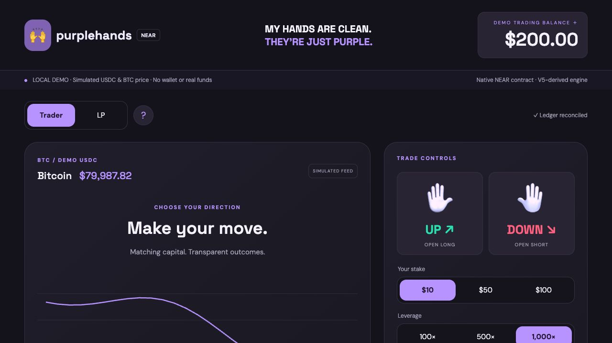

## Connected NEAR testnet preview

The wallet frontend, live trusted BTC oracle and automatic keeper are implemented. See [testnet app instructions](docs/TESTNET-APP.md). Run `npm run api:testnet`, `npm run worker:testnet` and `npm run dev:testnet`, then open http://127.0.0.1:8891. Mock tokens only; services currently run on the operator laptop. `npm run dev` remains the separate offline simulation.

# NEAR Purple Hands

A native Rust/NEAR implementation of Yellowhands trading: capped BTC positions against a reserved LP pool. This public hackathon repository contains contracts, accounting engine, oracle relay, keeper/status services, deployment tooling, tests, local demo and NEAR interfaces.

## Current pilot

- Live interface: [yellowhands.wtf/near](https://yellowhands.wtf/near).
- Native NEAR settlement using real USDC; the deployed pilot uses $10 margin × 500 leverage. This is an unaudited, restricted pilot.
- [Hyperliquid relay and verified settlement architecture](docs/NEAR-HYPERLIQUID-PILOT.md). Live chart estimates and finalized onchain settlement are distinct.
- [Current interface source snapshot](frontend/README.md), plus the runnable standalone interface in `mainnet/yellow/`.
- Backend services are in `mainnet/service/`; native contracts are in `contracts/` and shared accounting in `crates/engine/`.
- Historical deployment manifests and testnet sections describe specific earlier versions; they are not live health reports. Private keys, API credentials and runtime state are deliberately excluded.

The local demo below uses simulated funds. Testnet deployments use mock tokens.



## Testnet contracts

- Exchange: `exchange.near-purple-hands-20261102.testnet`
- Mock token (not USDC): `token.near-purple-hands-20261102.testnet`
- [Exchange explorer](https://testnet.nearblocks.io/address/exchange.near-purple-hands-20261102.testnet)
- Deployment hashes and public transaction receipts: [testnet manifest](deployments/testnet.json).
- Run `npm run verify:testnet` for read-only bytecode/finality/ledger checks.
- The connected testnet UI is available locally; its healthy oracle/keeper enables entries. Always-on hosting remains to be configured.

Private testnet credentials stay in the Git-ignored `.local/testnet-keys/` directory; never upload it. The browser demo below is still simulated and does not use these contracts.

## Run the local product

Prerequisites: Rust 1.96.1, Node.js 22+, a C compiler (Xcode Command Line Tools on macOS). First build downloads Rust dependencies.

```sh
npm run dev
```

Open **http://127.0.0.1:8890**. No npm dependencies are needed for the browser demo. It uses the same Rust accounting library as the NEAR contract, invoked through a local JSON-lines process. It **does not send browser actions to a blockchain**. The feed, keeper, accounts, and funds are simulated. Restarting the process resets everything; refreshing the page does not.

1. Click a hand to open a $10 trade at 500×.
2. Watch entry queue for two simulated blocks, then see live price-performance P&L and an entry line.
3. Click EXIT. After the delayed fill, see the after-fee receipt and updated balance.
4. Switch to LP; add liquidity when the book is empty. Request a 10% removal, wait the **60-second demo** countdown, then claim into the demo LP account. The contract notice is **24 hours**.
5. The top balance button adds $100 in simulated tokens. It is not an onramp.

Only loopback port 8890 is bound. Do not expose this simulator publicly: its deterministic local identities are deliberately unauthenticated.

## Native NEAR contract

`contracts/exchange` is a real NEAR WASM contract, not an Aurora/EVM wrapper. `crates/engine` supplies deterministic integer accounting. `contracts/mock-token` is a standard-based NEP-141 **test fixture**, not real USDC.

```sh
rustup target add wasm32-unknown-unknown
cargo test --workspace --locked
npm ci
npm run build:contract
npm run test:sandbox
```

Artifact: `artifacts/near_purple_exchange.wasm` (Binaryen-lowered for runtime compatibility). Sandbox runtime is pinned to nearcore 2.14.0; the harness default 2.6.2 cannot load current SDK imports.

The sandbox test creates disposable accounts and tests actual WASM execution, token deposits, LP minting, delayed trading, successful FT withdrawals and failed-transfer refunds. It uses no mainnet/testnet account or user keys. npm dependencies are used for tests and testnet deployment scripts; the product server has no third-party runtime npm dependencies.

## Implemented

- NEP-141 deposit receiver restricted to one configured six-decimal token.
- Owner withdrawals with pre-debit, one pending request per owner, and private asynchronous refund callbacks.
- $10 margin and 500× leverage; symmetrical ±stake payout cap.
- 1:1 LP reservation, 90% utilization ceiling, $100 minimum free buffer, $800k gross/$400k per-side limits.
- Two-block delayed open/close; price bounds; permissionless fills, expiry cancellation and forced settlement.
- 1% entry fee credited to LPs exactly once; 10% rake on the winner’s gain; 1% early-exit fee under 30 seconds, capped by available payout; $0.14 keeper escrow with unused refund.
- 80% loss forced settlement on either side; one-day expiry.
- Account-based agent sessions with expiry (up to seven days), cumulative margin budgets, revocation, and no delegated withdrawals.
- LP minting only on an empty book; permissionless mature redemption into the **owner’s** withdrawable balance.
- Freshness/sequence checks for the configured demo oracle; observed-outage clock reset on every accepted healthy publication.
- Bounded state (256 registered accounts), events and accounting reconciliation.

See [architecture and boundaries](docs/ARCHITECTURE.md), [V5 port differences](docs/V5-PORT.md), and [verification](docs/VERIFICATION.md). This is a prototype, not a completed production port or an audit.

## Domain and deployment

Target brand/domain: **purplehands.wtf**. Live Yellowhands remains independent. No DNS or current website mapping is changed by this repository or its scripts. Before a public preview, create a separate deployment and move only Purple Hands’ domain; never replace the shared production project serving Yellowhands. GitHub is source hosting, not a deployed backend.

Next stage: tester wallet verification, always-on hosting, decentralized oracle design and complete durable event indexing, then independent security review before any real-funds deployment. There is no mainnet deploy script.

## Hackathon provenance

Built for NEAR HACKATHON 2026; proposed track: DeFi. No application has been submitted. Repository visibility can remain private during development; it must be made public before submission/judging under the brief.

Pre-existing baseline: [boogaav/purple-hands at dc0063dca2caf0cef69d730c003958d3fdab2287](https://github.com/boogaav/purple-hands/tree/dc0063dca2caf0cef69d730c003958d3fdab2287). V5’s economic design and the Purple Hands visual language predate this fork. The Rust engine, native NEAR adapter, local backend, demo UI implementation and tests were written for this NEAR fork on 2026-11-02. This repo starts from a provenance-only baseline commit tagged `pre-near-implementation`; compare it with `main` to isolate the integration. Yellowhands/HyperEVM and the separate TON exploration are related projects; this submission claims only this NEAR implementation, not those baselines.

AI assistance: OpenAI Codex helped implement and test the fork. Libraries: NEAR SDK and contract standards, Serde, Borsh; NEAR Workspaces for local testing. Dependency licenses remain their respective authors’. New project code: MIT.

Official references: [NEAR contracts](https://docs.near.org/), [asynchronous calls](https://docs.near.org/smart-contracts/anatomy/crosscontract), [NEP-141](https://github.com/near/NEPs/blob/master/neps/nep-0141.md), [NEAR Workspaces](https://github.com/near/near-workspaces-js).

Mainnet V1 preparation and open launch blockers: [readiness review](docs/MAINNET-READINESS.md). Read-only preflight: `node scripts/preflight-mainnet.mjs`. New request storage is not compatible with an in-place upgrade of the existing testnet deployment.

The fixed BTC pilot uses `purple-hands-500x-v1.testnet` and mock USDC. Start the API and worker with `npm run api:testnet` and `npm run worker:testnet`. The worker requires the local Pyth credential and forwards signed reports. Trading requires a fresh accepted report, funded LP capital and guardian activation. The older deployment and smoke script use the test publisher.
